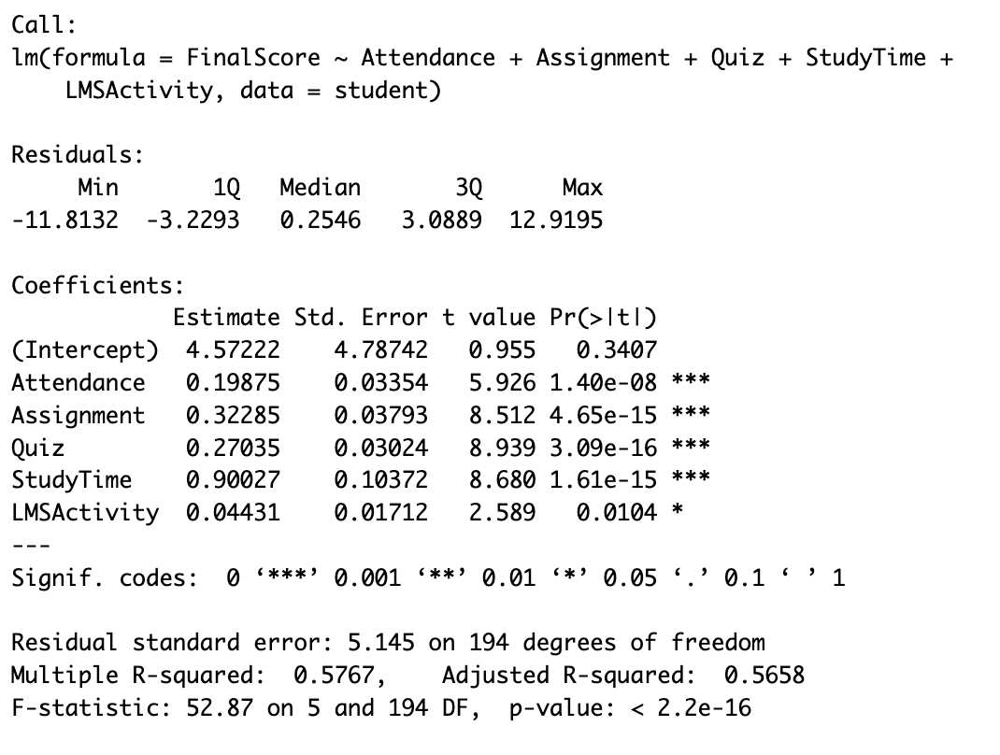
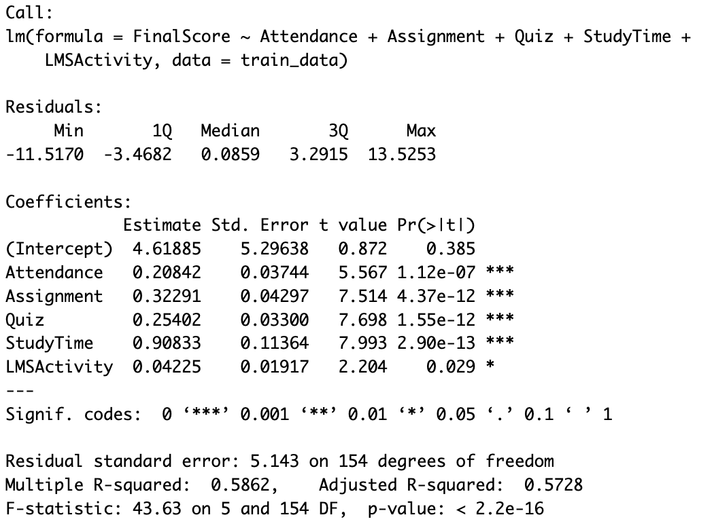
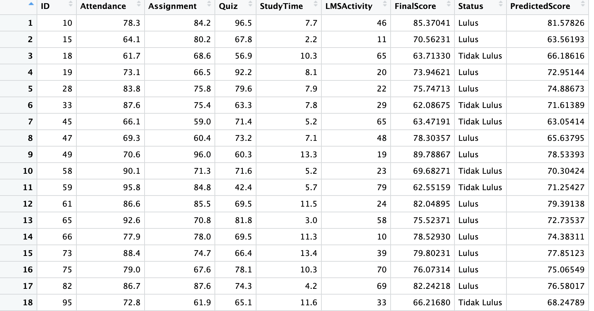

## Tujuan Pembelajaran

Setelah mengikuti rangkaian pembelajaran ini, mahasiswa diharapkan mampu:

1. menjelaskan konsep **prediksi** dalam Educational Data Mining;
2. membangun model regresi untuk memprediksi hasil belajar siswa;
3. membangun model *decision tree* untuk melakukan prediksi;
4. membedakan masalah prediksi numerik dan kategorik;
5. mengevaluasi performa model menggunakan metrik yang sesuai;
6. membandingkan performa dua model dan memberikan interpretasi berdasarkan konteks pendidikan.


## Prediksi dalam *Educational Data Mining*

Dalam pembelajaran sebelumnya, kita telah menggunakan data pendidikan untuk:

- mengenali karakteristik data;
- melakukan *preprocessing*;
- mengeksplorasi pola melalui EDA;
- membuat visualisasi;
- menginterpretasikan hubungan antarvariabel.
- Memahami *supervised* dan *unsupervised learning*

## Regresi dan *Decision tree* sebagai ragam *supervised learning*

- Pada materi sebelumnya, kita telah membahas supervised learning sebagai pendekatan yang menggunakan data dengan target/label untuk membangun model;

- Pada pertemuan ini, kita akan melihat bagaimana konsep tersebut diterapkan pada data pendidikan melalui dua kasus:

  - memprediksi nilai siswa;
  - memprediksi kategori/status siswa.
   
## Prediksi {.scrollable}

Secara sederhana:

$$
\text{Data siswa}
\rightarrow
\text{Model}
\rightarrow
\text{Prediksi}
$$

Contohnya, kita ingin menjawab pertanyaan:

> Berdasarkan kehadiran, nilai tugas, aktivitas LMS, dan waktu belajar, berapa kira-kira nilai akhir seorang siswa?

Atau:

> Berdasarkan karakteristik tersebut, apakah seorang siswa diperkirakan **lulus** atau **tidak lulus**?

Pertanyaan pertama menghasilkan **nilai numerik**, sedangkan pertanyaan kedua menghasilkan **kategori**.


## Dua bentuk prediksi {.scrollable}

| Jenis prediksi | Target | Contoh |
|---|---|---|
| Regresi | Numerik | Memprediksi nilai akhir |
| Classification | Kategorik | Memprediksi lulus/tidak lulus |

Pada materi ini kita menggunakan dua pendekatan:

- **Regresi** untuk memprediksi nilai;
- **Decision Tree** untuk melakukan prediksi berbasis aturan.


## Dataset pendidikan {.scrollable}

Kita menggunakan contoh data siswa dengan variabel:

| Variabel | Keterangan |
|---|---|
| `ID` | Identitas siswa |
| `Attendance` | Persentase kehadiran |
| `Assignment` | Nilai tugas |
| `Quiz` | Nilai kuis |
| `StudyTime` | Waktu belajar per minggu |
| `LMSActivity` | Jumlah aktivitas pada LMS |
| `FinalScore` | Nilai akhir |
| `Status` | Status kelulusan |

## Dataset pendidikan (2) {.scrollable}

Berikut dataset yang digunakan pada konteks materi ini:

```{r}
library(tidyverse)
library(rpart)
library(rpart.plot)
library(caret)
```

```{r}
set.seed(123)

n <- 200

student <- tibble(
  ID = 1:n,
  Attendance = round(runif(n, 60, 100), 1),
  Assignment = round(rnorm(n, 75, 10), 1),
  Quiz = round(rnorm(n, 72, 12), 1),
  StudyTime = round(runif(n, 2, 15), 1),
  LMSActivity = round(runif(n, 5, 80))
)

student <- student |>
  mutate(
    FinalScore =
      0.25 * Attendance +
      0.35 * Assignment +
      0.25 * Quiz +
      0.8 * StudyTime +
      0.05 * LMSActivity +
      rnorm(n, 0, 5)
  ) |>
  mutate(
    FinalScore = pmin(pmax(FinalScore, 0), 100),
    Status = if_else(FinalScore >= 70, "Lulus", "Tidak Lulus")
  )

head(student)
```


# Regresi 

## Apa itu Regresi? {.scrollable}

Regresi digunakan ketika kita ingin memprediksi **nilai numerik**.

Misalnya:

> Berapa nilai akhir yang diperkirakan akan diperoleh seorang siswa berdasarkan kehadiran, nilai tugas, dan aktivitas belajarnya?

Model regresi sederhana dapat dituliskan sebagai:

$$
Y = \beta_0 + \beta_1X_1 + \beta_2X_2 + \cdots + \epsilon
$$

Dalam konteks kita:

$$
FinalScore =
\beta_0 +
\beta_1 Attendance +
\beta_2 Assignment +
\beta_3 Quiz +
\beta_4 StudyTime +
\beta_5 LMSActivity +
\epsilon
$$

Secara konseptual, model mencari hubungan antara karakteristik siswa dan hasil belajar.


## Membangun Model Regresi {.scrollable}

:::: {.columns}
::: {.column width="50%"}

Kita dapat menggunakan fungsi `lm()` dalam R.

```{r, echo=TRUE, eval=FALSE}
model_reg <- lm(
  FinalScore ~ Attendance +
    Assignment +
    Quiz +
    StudyTime +
    LMSActivity,
  data = student
)

summary(model_reg)
```

{width="90%"}

:::

::: {.column width="50%"}

- Output tersebut memberikan informasi mengenai:

   - koefisien regresi;
   - arah hubungan;
   - besar pengaruh;
   - signifikansi statistik;
   - dan ukuran kecocokan model.

- Namun dalam konteks prediksi, kita tidak hanya tertarik pada signifikansi koefisien.

- Pertanyaan yang lebih penting adalah:

   > Seberapa baik model dapat memprediksi data yang belum pernah dilihat?

:::

::::


## Melihat Koefisien Model {.scrollable}

```{r}
load("data/model_reg.RData")
coef(model_reg)
```

Misalnya, jika koefisien `Assignment` bernilai positif, maka secara model:

> siswa dengan nilai tugas yang lebih tinggi cenderung memiliki prediksi nilai akhir yang lebih tinggi, dengan variabel lain dianggap tetap.

Perhatikan bahwa interpretasi ini berbeda dari sekadar mengatakan:

> "Assignment menyebabkan FinalScore meningkat."

Model regresi menunjukkan **hubungan dalam model**, bukan otomatis hubungan sebab-akibat.


## Membuat Prediksi dari hasil regresi {.scrollable}

Kita dapat menggunakan model untuk menghasilkan nilai prediksi.

:::: {.columns}
::: {.column width="50%"}

```{r, echo=TRUE}
student <- student |>
  mutate(
    PredictedScore = predict(model_reg)
  )

student |>
  select(
    ID,
    FinalScore,
    PredictedScore
  ) |>
  head(10)
```
:::

::: {.column width = "50%"}

Sekarang kita memiliki dua nilai:

| Nilai | Makna |
|---|---|
| `FinalScore` | Nilai aktual |
| `PredictedScore` | Nilai yang diprediksi model |

:::
::::

## Membandingkan nilai aktual dan nilai prediksi {.scrollable}

:::: {.columns}
::: {.column width = "50%"}

```{r, echo=TRUE, eval=FALSE}

ggplot(
  student,
  aes(
    x = FinalScore,
    y = PredictedScore
  )
) +
  geom_point(alpha = 0.6) +
  geom_abline(
    slope = 1,
    intercept = 0,
    linetype = "dashed"
  ) +
  labs(
    x = "Nilai Aktual",
    y = "Nilai Prediksi",
    title = "Nilai Aktual vs Nilai Prediksi"
  ) +
  theme_minimal()
```
:::

::: {.column width = "50%"}
```{r}

ggplot(
  student,
  aes(
    x = FinalScore,
    y = PredictedScore
  )
) +
  geom_point(alpha = 0.6) +
  geom_abline(
    slope = 1,
    intercept = 0,
    linetype = "dashed"
  ) +
  labs(
    x = "Nilai Aktual",
    y = "Nilai Prediksi",
    title = "Nilai Aktual vs Nilai Prediksi"
  ) +
  theme_minimal()
```
:::
::::

"Semakin dekat titik-titik terhadap garis diagonal, semakin dekat nilai prediksi dengan nilai aktual."


## *Trained Data* dan *Test Data* {.scrollable}

:::: {.columns}
::: {.column width = "50%"}

- Salah satu hal penting dalam prediksi adalah:

   > Jangan menguji kemampuan model hanya menggunakan data yang digunakan untuk membangun model.


- Kita membagi data menjadi:

   - **training data** → digunakan membangun model;
   - **testing data** → digunakan mengevaluasi model.
:::

::: {.column width = "50%"}

```{r, echo=TRUE}
set.seed(123)

train_id <- sample(
  seq_len(nrow(student)),
  size = 0.8 * nrow(student)
)     # memecah/membagi/memenggal student data menjadi 2 kelompok

train_data <- student[train_id, ]
test_data <- student[-train_id, ]

nrow(train_data) #banyaknya baris pada trained data
nrow(test_data) #banyaknya baris pada test_data
```
:::
::::

## Membangun model dengan Training Data {.scrollable}

:::: {.columns}
::: {.column width = "50%"}
ini dilakukan dengan cara yang sama [Lihat kembali Model Regresi](#slide-regresi)

```{r, echo=TRUE, eval=FALSE}
model_train <- lm(
  FinalScore ~ Attendance +
    Assignment +
    Quiz +
    StudyTime +
    LMSActivity,
  data = train_data
)

summary(model_train)
```

{width="90%"}

:::

::: {.column width = "50%"}
Kemudian prediksi dilakukan pada **test data**.

```{r, echo=TRUE,eval=FALSE}
test_data <- test_data |>
  mutate(
    PredictedScore = predict(
      model_train,
      newdata = test_data
    )
  )
```

{width="90%"}

- Dengan demikian kita menguji:

     > Seberapa baik model yang dibangun dari training data memprediksi siswa yang tidak digunakan saat membangun model?

:::
::::

# Praktikum 1 — Regresi for EDM {.scrollable}

## Tujuan

Membangun model untuk memprediksi nilai akhir siswa.

## Langkah

1. Pisahkan data menjadi training dan testing.
2. Bangun model regresi.
3. Gunakan model untuk memprediksi nilai pada testing data.
4. Buat visualisasi nilai aktual dan prediksi.
5. Interpretasikan hasil.

## Pertanyaan Analisis

Jawab pertanyaan berikut:

1. Variabel apa saja yang digunakan sebagai predictor?
2. Variabel mana yang memiliki hubungan positif dengan `FinalScore`?
3. Apakah prediksi model terlihat mendekati nilai aktual?
4. Apakah menurut Anda model tersebut sudah cukup baik untuk digunakan memprediksi siswa?
5. Apa konsekuensi jika model memprediksi nilai siswa terlalu tinggi atau terlalu rendah?


# *Decision Tree*

## Apa itu Desicion tree? {.scrollable}

- Regresi bukan satu-satunya pendekatan prediksi.

- Pendekatan lain adalah **Decision Tree**.

- Decision tree menghasilkan aturan keputusan berbentuk percabangan.

- Contoh sederhana:

```text
Attendance < 75?
│
├── Ya
│   └── Assignment < 70?
│       ├── Ya → Tidak Lulus
│       └── Tidak → Lulus
│
└── Tidak
    └── Assignment ≥ 70?
        ├── Ya → Lulus
        └── Tidak → Lulus
```

- Dengan demikian, decision tree dapat membantu kita menjawab:

    > Karakteristik seperti apa yang membedakan kelompok siswa yang diprediksi lulus dan tidak lulus?


## Klasifikasi dengan Decision Tree {.scrollable}

Untuk contoh ini kita menggunakan `Status`:

- `Lulus`
- `Tidak Lulus`

```{r, echo=TRUE}
student <- student |>
  mutate(
    Status = factor(
      Status,
      levels = c("Tidak Lulus", "Lulus")
    )
  )
```

Kita kembali membagi data menjadi training dan testing.

```{r, echo=TRUE}
set.seed(123)

train_id <- sample(
  seq_len(nrow(student)),
  size = 0.8 * nrow(student)
)

train_data <- student[train_id, ]
test_data <- student[-train_id, ]
```


## Membuat Decision Tree {.scrollable}

Kita menggunakan package `rpart`.

```{r, echo=TRUE}
tree_model <- rpart(
  Status ~ Attendance +
    Assignment +
    Quiz +
    StudyTime +
    LMSActivity,
  data = train_data,
  method = "class"
)
```

Visualisasikan pohon:

```{r, echo=TRUE}
rpart.plot(
  tree_model,
  type = 4,
  extra = 104,
  fallen.leaves = TRUE
)
```

- Decision tree dapat dibaca dari atas ke bawah.

- Setiap percabangan menunjukkan suatu kondisi.

- Misalnya:

```text
Assignment < 68
```

berarti model menggunakan nilai tugas sebagai salah satu dasar untuk membagi siswa.


## Membuat prediksi dengan Decision Tree {.scrollable}

```{r, echo=TRUE}
test_data <- test_data |>
  mutate(
    PredictedStatus = predict(
      tree_model,
      newdata = test_data,
      type = "class"
    )
  )

head(
  test_data |>
    select(
      ID,
      Status,
      PredictedStatus
    )
)
```

Sekarang kita dapat membandingkan:

- `Status` → kondisi aktual;
- `PredictedStatus` → hasil prediksi model.


## Membandingkan Dua Model {.scrollable}

- Sekarang kita memiliki dua pendekatan:

| Model | Target | Bentuk output |
|---|---|---|
| Regresi | `FinalScore` | Nilai numerik |
| Decision Tree | `Status` | Kategori |

- Keduanya sama-sama melakukan prediction, tetapi menjawab pertanyaan yang berbeda.

### Regresi

      > "Berapa nilai akhir siswa?"

### Decision Tree

      > "Apakah siswa diprediksi lulus atau tidak?"

- Karena targetnya berbeda, metrik evaluasinya juga berbeda.

# Praktikum 2 — *Decision Tree* {.scrollable}

## Tujuan {.scrollable}

Membangun *decision tree* untuk memprediksi status kelulusan siswa.

```{r, echo=TRUE}
tree_model <- rpart(
  Status ~ Attendance +
    Assignment +
    Quiz +
    StudyTime +
    LMSActivity,
  data = train_data,
  method = "class"
)

rpart.plot(
  tree_model,
  type = 4,
  extra = 104,
  fallen.leaves = TRUE
)
```

## Tugas {.scrollable}

Mahasiswa diminta untuk

1. membangun decision tree;
2. menampilkan visualisasi tree;
3. mengidentifikasi variabel yang digunakan pada percabangan awal;
4. menjelaskan minimal dua aturan keputusan dari tree;
5. melakukan prediction pada testing data;
6. menyimpulkan karakteristik siswa yang diprediksi lulus.

### Pertanyaan refleksi

> Apakah decision tree lebih mudah dijelaskan kepada guru dibandingkan model regresi?

Berikan alasan berdasarkan hasil model.


## Evaluasi Performa Model Prediction

Membangun model saja belum cukup.

Kita perlu menjawab:

> Seberapa baik model melakukan prediction?

Cara menjawabnya adalah menggunakan **evaluation metrics**.

Metrik yang digunakan bergantung pada jenis prediction.


# Evaluasi Regresi

Untuk Regresi, beberapa metrik yang umum digunakan adalah:

- MAE;
- RMSE;
- $R^2$.

## RMSE {.scrollable}

RMSE (*Root Mean Squared Error*) mengukur besar rata-rata kesalahan prediksi dengan memberikan penalti lebih besar terhadap kesalahan yang besar.

$$
RMSE =
\sqrt{
\frac{1}{n}
\sum_{i=1}^{n}
(y_i-\hat{y}_i)^2
}
$$

Semakin kecil RMSE, semakin dekat prediksi terhadap nilai aktual.


## Menghitung RMSE dengan R {.scrollable}

```{r, echo=TRUE}
actual <- test_data$FinalScore

predicted <- test_data$PredictedScore

RMSE <- sqrt(
  mean(
    (actual - predicted)^2
  )
)

RMSE
```

Kita juga dapat menggunakan fungsi dari `caret`.

```{r, echo=TRUE}
postResample(
  pred = predicted,
  obs = actual
)
```

Output nantinya memberikan:

- RMSE;
- $R^2$;
- MAE.


## Evaluasi Classification {.scrollable}

Untuk classification, kita dapat menggunakan:

- Accuracy;
- Precision;
- Recall.

Salah satu cara melihat hasil klasifikasi adalah melalui **confusion matrix**.

```text
                         Aktual
                    Tidak Lulus   Lulus

Prediksi
Tidak Lulus              TN         FN

Lulus                    FP         TP
```

Keterangan:

- **TP** (*True Positive*) → siswa lulus dan diprediksi lulus;
- **TN** (*True Negative*) → siswa tidak lulus dan diprediksi tidak lulus;
- **FP** (*False Positive*) → siswa tidak lulus tetapi diprediksi lulus;
- **FN** (*False Negative*) → siswa lulus tetapi diprediksi tidak lulus.


## Accuracy {.scrollable}

Accuracy menunjukkan proporsi prediksi yang benar.

$$
Accuracy =
\frac{TP+TN}
{TP+TN+FP+FN}
$$

Dalam R:

```{r}
confusionMatrix(
  test_data$PredictedStatus,
  test_data$Status
)
```

Perhatikan bagian:

```text
Accuracy
```


## Precision {.scrollable}

Precision menjawab pertanyaan:

> Dari semua siswa yang diprediksi lulus, berapa yang benar-benar lulus?

$$
Precision =
\frac{TP}
{TP+FP}
$$

Precision penting ketika **false positive** menjadi perhatian.

Misalnya sekolah menggunakan model untuk memilih siswa yang dianggap sudah aman untuk naik tingkat.


## Recall {.scrollable}

Recall menjawab:

> Dari semua siswa yang sebenarnya lulus, berapa yang berhasil dikenali oleh model?

$$
Recall =
\frac{TP}
{TP+FN}
$$

Dalam konteks pendidikan, recall dapat menjadi penting ketika kita ingin **mengidentifikasi sebanyak mungkin siswa yang membutuhkan perhatian**.

Misalnya kita membalik definisi kelas positif menjadi:

> "Berisiko tidak lulus."

Maka recall menunjukkan seberapa banyak siswa yang benar-benar berisiko berhasil dikenali oleh model.


## Classification Threshold {.scrollable}

Pada model probabilistik, prediction dapat bergantung pada threshold.

Misalnya:

```text
Probability ≥ 0.50 → Lulus
Probability < 0.50 → Tidak Lulus
```

Jika threshold diubah, jumlah:

- TP;
- FP;
- TN;
- FN

juga dapat berubah.

Hal ini menunjukkan bahwa **accuracy bukan satu-satunya hal yang perlu diperhatikan**.


## Evaluasi Decision Tree dengan Confusion Matrix

```{r, echo=TRUE}
cm <- confusionMatrix(
  test_data$PredictedStatus,
  test_data$Status
)

cm
```

Kita dapat mengambil accuracy:

```{r, echo=TRUE}
cm$overall["Accuracy"]
```

Untuk mendapatkan informasi lain:

```{r, echo=TRUE}
cm$byClass
```

Perhatikan:

- Sensitivity;
- Specificity;
- Precision;
- dan metrik lainnya.

Dalam kasus dua kelas, sensitivity dapat digunakan sebagai ukuran *recall*.


# Praktikum 3 — Evaluasi Model

Gunakan model yang telah dibuat pada praktikum sebelumnya.

## Bagian A — Regresi {.scrollable}

Hitung:

- RMSE;
- MAE;
- $R^2$.

```{r, echo=TRUE}
pred_reg <- predict(
  model_reg,
  newdata = test_data
)

postResample(
  pred = pred_reg,
  obs = test_data$FinalScore
)
```

Interpretasikan hasilnya.


## Bagian B — Decision Tree {.scrollable}

Hitung:

- confusion matrix;
- accuracy;
- precision;
- recall.

```{r, echo=TRUE}
pred_tree <- predict(
  tree_model,
  newdata = test_data,
  type = "class"
)

confusionMatrix(
  pred_tree,
  test_data$Status
)
```


## Membandingkan Model {.scrollable}

Misalkan kita memperoleh hasil:

| Model | RMSE | Accuracy |
|---|---:|---:|
| Regresi | 5.82 | — |
| Decision Tree | — | 0.87 |

Kita **tidak boleh langsung mengatakan**:

> "Regresi lebih baik karena RMSE 5.82 lebih kecil daripada accuracy 0.87."

Mengapa?

Karena keduanya mengukur **hal yang berbeda**.

Regresi memprediksi:

$$
\text{nilai numerik}
$$

sedangkan classification memprediksi:

$$
\text{kategori}
$$

Perbandingan yang tepat adalah:

- Regresi dengan model Regresi lain → menggunakan RMSE/MAE/$R^2$;
- decision tree dengan model classification lain → menggunakan accuracy/precision/recall dan metrik lainnya.


## Prediction dalam Konteks Pendidikan {.scrollable}

Dalam EDM, performa model bukan satu-satunya pertanyaan.

Kita juga perlu bertanya:

> **Apa konsekuensi dari prediction tersebut?**

Misalnya model memprediksi seorang siswa:

```text
Prediksi: Tidak Lulus
Aktual:   Lulus
```

Ini merupakan **false negative**.

Apa akibatnya?

Guru mungkin:

- memberikan intervensi tambahan;
- memasukkan siswa ke kelompok remedial;
- meminta siswa mengikuti program pendampingan.

Padahal siswa sebenarnya tidak membutuhkan intervensi tersebut.

Sebaliknya:

```text
Prediksi: Lulus
Aktual:   Tidak Lulus
```

dapat menyebabkan siswa yang sebenarnya membutuhkan bantuan justru **tidak teridentifikasi**.

Karena itu, pemilihan model tidak seharusnya hanya berdasarkan:

> "Model mana yang memiliki accuracy paling tinggi?"

Tetapi juga:

> "Kesalahan prediksi mana yang paling penting untuk dihindari dalam konteks pendidikan?"


## Aktivitas Analisis {.scrollable}

Gunakan hasil model yang telah dibuat.

Jawab pertanyaan berikut dalam 1–2 paragraf untuk setiap pertanyaan.

### 1. Memahami Model

Apa variabel yang paling banyak digunakan model dalam menentukan prediction?

### 2. Memahami Kesalahan

Temukan contoh siswa yang prediction-nya salah.

Apakah kesalahan tersebut:

- false positive; atau
- false negative?

### 3. Konteks Pendidikan

Apa konsekuensi kesalahan tersebut jika model digunakan oleh guru?

### 4. Pemilihan Metrik

Jika tujuan sekolah adalah:

> "Jangan sampai siswa yang benar-benar berisiko tidak teridentifikasi."

Apakah accuracy sudah cukup?

Jelaskan metrik yang lebih relevan.

### 5. Interpretasi

Apakah model yang memiliki performa statistik lebih baik selalu merupakan model yang lebih baik untuk digunakan di sekolah?

Berikan alasan.


## Mini Project {.scrollable}

Gunakan dataset pendidikan yang berbeda dari contoh di atas.

Dataset dapat berasal dari:

- data akademik;
- data LMS;
- data kehadiran;
- data asesmen;
- data aktivitas pembelajaran;
- atau dataset pendidikan publik.

## Tahapan

### Tahap 1 — Data

Jelaskan:

- sumber data;
- unit analisis;
- variabel;
- target prediction.

### Tahap 2 — Prediction

Bangun minimal:

1. satu model Regresi **atau**
2. satu model classification menggunakan decision tree.

### Tahap 3 — Evaluation

Evaluasi model menggunakan metrik yang sesuai.

### Tahap 4 — Interpretation

Jelaskan:

- apa yang diprediksi;
- seberapa baik model bekerja;
- jenis kesalahan yang muncul;
- konsekuensi kesalahan tersebut dalam konteks pendidikan.


## Checklist Praktikum {.scrollable}

Mahasiswa dianggap menyelesaikan praktikum apabila mampu:

- [ ] membedakan Regresi dan classification;
- [ ] membagi data menjadi training dan testing;
- [ ] membangun model Regresi menggunakan `lm()`;
- [ ] membuat prediction menggunakan `predict()`;
- [ ] membangun decision tree menggunakan `rpart()`;
- [ ] membaca struktur decision tree;
- [ ] membuat confusion matrix;
- [ ] menghitung RMSE;
- [ ] memahami accuracy, precision, dan recall;
- [ ] menjelaskan arti kesalahan prediction;
- [ ] menghubungkan hasil model dengan konteks pendidikan.


## Ringkasan {.scrollable}

Alur prediction dalam EDM dapat diringkas sebagai berikut:

```text
Data Pendidikan
      ↓
Preprocessing
      ↓
Training Data ───────→ Testing Data
      ↓                    ↓
   Bangun Model          Prediction
      ↓                    ↓
      └──────────────→ Evaluation
                           ↓
                    Interpretation
                           ↓
                    Educational Action
```

Hal penting yang perlu diingat:

> **Model prediction bukan tujuan akhir EDM.**

Model digunakan untuk membantu kita memahami pola dan membuat keputusan yang lebih informasional. Dalam konteks pendidikan, prediction perlu diterjemahkan kembali ke dalam pertanyaan:

> **Apa yang dapat dilakukan guru atau sekolah berdasarkan hasil prediction tersebut?**